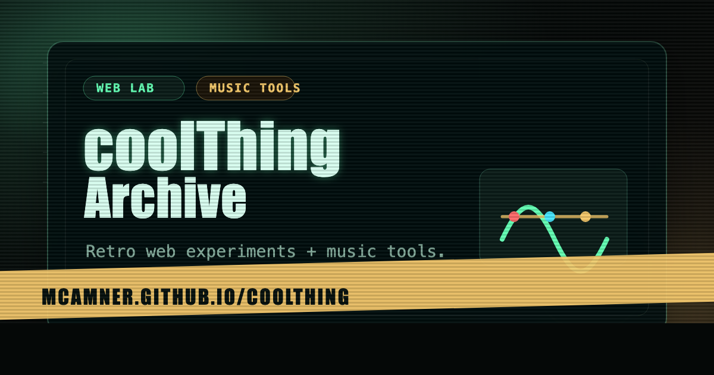

# coolThing 🎸✨

[](LICENSE)
[](VERSION)
[](https://www.python.org/downloads/)
[](https://github.com/mcamner/coolThing/graphs/commit-activity)

Retro web experiments, local music tools, and small repo utilities.

**Live site:** [https://mcamner.github.io/coolThing/](https://mcamner.github.io/coolThing/)

---

## What's inside

- `docs/` - static GitHub Pages site and browser experiments
- `backend/` - local FastAPI backend for music features
- `tools/` - shell scripts for local development and repo workflow

## Projects

### Motion / rörelselabb (lokal React-demo)

Spring-rubrik, tre hover-kort, scrollutlöst fade-in och mjuka layoutövergångar,
med stöd för minskad rörelse. Kör separat med Vite; ingår inte i GitHub Pages.

- **Kod och körinstruktioner:** [motion-demo/README.md](motion-demo/README.md)

### 👁 PromptImage

AI Vision for Perchance.org. Upload an image to generate positive and negative prompts with local Ollama (qwen3.5:9b) by default, or optionally GPT-4o-mini with `OPENAI_API_KEY`.

- **Files:** `docs/prompt-image/index.html`, `backend/app.py`
- **Local:** `http://localhost:3000/prompt-image/`

### 🎸 Mega Guitar Tabs

MTV-style guitar tab generator prototype. The browser UI sends a YouTube URL to the local backend, which downloads audio, runs Basic Pitch transcription, detects chords, transcribes lyrics (via Whisper), and returns a generated guitar tab.

- **Files:** `docs/mega-guitar/`, `backend/app.py`
- **Live Demo:** [Mega Guitar](https://mcamner.github.io/coolThing/mega-guitar/?v=mtv1)

### 🎵 Mega Now

Spotify "now playing" display with album art, audio features, and handoff to Mega Guitar.

- **Files:** `docs/mega-now/index.html`, `backend/app.py`
- **Local:** `http://localhost:3000/mega-now/`

### 🔣 MQ-ASCII

Image to ASCII art in the browser. Shows the full pipeline (resize, luminance, bucket, character, ANSI color) for any selected cell and exports text, ANSI, PNG or a matching Python/Pillow script. No backend.

- **Files:** `docs/mq-ascii/index.html`
- **Live Demo:** [MQ-ASCII](https://mcamner.github.io/coolThing/mq-ascii/)

### 🎬 VFX

Film effects bench in the browser. Paint practical-style effects (blood, gloss, gold, vaseline, frosted glass, glitter, UV paint, scorch, bruise, lens flare, glitch) onto your own image, add whole-image filters and save as PNG. No backend.

- **Files:** `docs/vfx/index.html`
- **Live Demo:** [VFX](https://mcamner.github.io/coolThing/vfx/)

### 🎼 MQ-TAB

Guitar Pro reader and player in the browser. Open `.gp3`–`.gp5`, `.gpx`, `.gp` (Guitar Pro 7/8) or MusicXML and follow notation and tab with a playback cursor. Show, mute or solo tracks, change tempo, loop a selected range, and turn on metronome or count-in. The **boxes** switch colours each tab number by the pentatonic box (1–5) it sits in, using the scale and box analysis from Pentabox. A strip above the score shows the analysed sections; pick one to read its scale and boxes (or why it is not coloured) and loop those bars. Below it, a fretboard shows the section's boxes and lights up the notes as they are played. Parsing, rendering and synthesis come from [alphaTab](https://alphatab.net) (MPL-2.0), loaded from jsDelivr. No backend.

- **Files:** `docs/mq-tab/index.html`, `docs/mq-tab/analysis.js`
- **Live Demo:** [MQ-TAB](https://mcamner.github.io/coolThing/mq-tab/)

---

## Quick start

### 🚀 Installation & Launch

Start the backend and local frontend together:

```bash
# Install dependencies and start servers
./tools/start.sh
```

Then open [http://localhost:3000/](http://localhost:3000/).

### 🛠 Individual components

- **Backend:** `./tools/run-mega-guitar-backend.sh`
- **Frontend:** `./tools/serve-frontend.sh`

---

## Examples

### 🖼 Generate Image Prompts

Use the PromptImage API directly:

```bash
curl -X POST http://127.0.0.1:8001/prompt-image -F "file=@image.jpg"
```

### 🎤 Local Lyrics Transcription

Example of using the API to transcribe lyrics:

```bash
curl -X POST http://127.0.0.1:8001/lyrics \
  -H "Content-Type: application/json" \
  -d '{"youtube_url":"https://www.youtube.com/watch?v=dQw4w9WgXcQ"}'
```

---

## Screenshots & Demo



---

## Roadmap

Check the [Roadmap](ROADMAP.md) for future plans:

- [ ] **Mobile App:** React Native wrapper for Mega Tuner and Setlist.
- [ ] **AI Harmony:** Add backing track generation using Riffusion.
- [ ] **PromptHistory:** Save previous image prompts in local storage.

---

## Contributing

We love contributions! Please see our [Contributing Guidelines](CONTRIBUTING.md) to get started.

1. Fork the repo
2. Create your feature branch (`git checkout -b feature/amazing-feature`)
3. Commit your changes (`git commit -m 'Add amazing feature'`)
4. Push to the branch (`git push origin feature/amazing-feature`)
5. Open a Pull Request

---

## Security & Safety

This project runs locally. Ensure your **OPENAI_API_KEY** and Spotify credentials are kept in a non-committed `.env` file. The backend does not expose ports to the public internet by default.

---

## License

[MIT](LICENSE) © 2026 Mattias Camner
